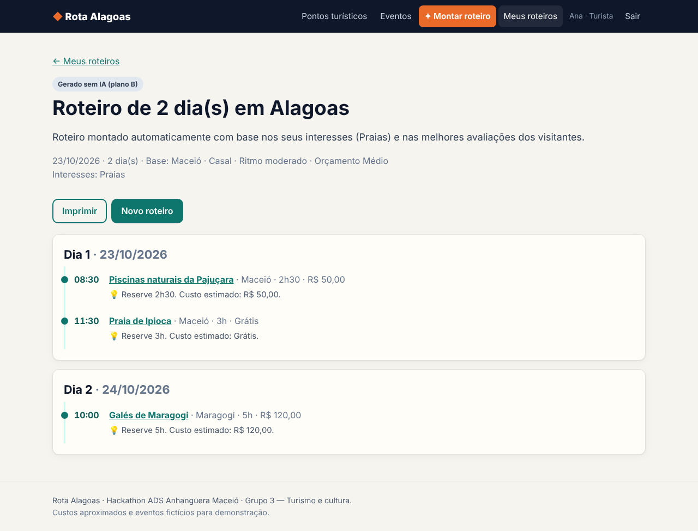

# ◆ Rota Alagoas

**Roteiros, guias e eventos de Alagoas para visitantes — com um assistente de IA que monta o roteiro pelo seu perfil e pelo seu tempo.**

Projeto do **Hackathon ADS · Anhanguera Maceió** — **Grupo 3 · Turismo e cultura**
Equipe: Eduardo Lucas (cabeça de chave), José Eduardo Souza da Silva, José Wellington da Silva Vieira, Kelvin Gadelha e Matheus.



---

## O que o sistema faz

| Usuário | Pode |
|---|---|
| **Turista** | Explorar pontos turísticos e eventos, avaliar lugares, **gerar roteiros com IA** e guardá-los em "Meus roteiros" |
| **Guia local** | Cadastrar, editar e excluir pontos turísticos |
| **Organizador de eventos** | Cadastrar, editar e excluir eventos |

### Recurso de IA — assistente de roteiros

- **Entra:** dias (1–7), data de chegada, cidade-base, interesses, companhia, ritmo e orçamento + os pontos turísticos (com nota média, tags de interesse, melhor período e se dependem da maré baixa) e os eventos do período, vindos do banco.
- **Sai:** um roteiro em JSON, dia a dia, com horário, lugar/evento e uma dica. O sistema valida a resposta e **descarta qualquer lugar que não exista no banco**.
- **Se falhar:** sem chave, sem internet, *timeout* ou resposta inválida → **plano B**: um algoritmo local monta o roteiro pelas notas e interesses, e a tela avisa "Roteiro montado sem IA". O sistema nunca fica sem resposta.
- **Modelo:** Google Gemini (`gemini-3.6-flash`, com modelos de reserva configuráveis em `config.php`).

## Tecnologias

PHP 8.1+ (sem framework) · MySQL/MariaDB · HTML + CSS puro · Google Gemini API · XAMPP · VS Code + GitHub Copilot · Trello · GitHub

---

## Como rodar (XAMPP)

1. **Copie a pasta** `rota-alagoas` para `C:\xampp\htdocs\`.
2. Abra o **XAMPP Control Panel** e inicie **Apache** e **MySQL**.
3. Acesse **http://localhost/phpmyadmin** → aba **Importar** → escolha `database/rota_alagoas.sql` → **Executar**.
   (O script cria o banco `rota_alagoas` com dados de exemplo e os 77 pontos turísticos da planilha de pesquisa do grupo.)
   **Já tinha o banco importado?** Para não perder roteiros e avaliações, importe só `database/atualizacao_pontos_planilha.sql` e depois `database/atualizacao_sugeridos.sql` (com o banco `rota_alagoas` selecionado).
   **Coordenadas dos pontos (opcional):** com internet, rode `php ferramentas/geocodificar_pontos.php` (XAMPP no Linux: `/opt/lampp/bin/php`). Ele busca no OpenStreetMap e gera `database/coordenadas_pontos.sql` para importar.
4. Na pasta `config`, **copie** `config.example.php` e renomeie a cópia para **`config.php`**.
5. *(Para usar a IA)* Gere uma chave gratuita em **https://aistudio.google.com/apikey** e cole em `config.php`:
   ```php
   'chave' => 'SUA_CHAVE_AQUI',
   ```
   Sem a chave o sistema funciona normalmente usando o plano B.
6. Abra **http://localhost/rota-alagoas**.

### Contas de demonstração (senha `123456`)

| Perfil | E-mail |
|---|---|
| Turista | `ana@rota.al` · `bruno@rota.al` |
| Guia local | `guia@rota.al` · `guia2@rota.al` |
| Organizador | `org@rota.al` |

### Problemas comuns

| Sintoma | Solução |
|---|---|
| "Não foi possível conectar ao banco" | MySQL ligado no XAMPP? Banco importado? Usuário/senha em `config.php` (XAMPP: `root`, senha vazia). |
| "Falta o arquivo config/config.php" | Faça o passo 4. |
| Roteiro sempre "sem IA" com `debug` mostrando *SSL certificate problem* | No XAMPP para Windows: baixe `cacert.pem` de https://curl.se/ca/cacert.pem, salve em `C:\xampp\php\extras\ssl\` e no `php.ini` defina `curl.cainfo = "C:\xampp\php\extras\ssl\cacert.pem"`. Reinicie o Apache. (Só em demo: `'verificar_ssl' => false`.) |
| `debug` mostra *HTTP 400 API key not valid* | Confira a chave do Gemini. |
| `debug` mostra *HTTP 404 model not found* | Troque `'modelo'` em `config.php` por um modelo disponível na sua conta. |
| `debug` mostra *HTTP 503 high demand* | O Google está sobrecarregado nesse modelo. Coloque em primeiro lugar, em `config.php`, um modelo que esteja respondendo. |
| Extensão cURL desativada | No `php.ini`, tire o `;` da linha `extension=curl` e reinicie o Apache. |

> Na apresentação, deixe `'debug' => false` para esconder os detalhes técnicos.

### Testes automatizados

```bash
C:\xampp\php\php.exe tests\testes_unitarios.php
```
Esperado: `Resultado: 23 passou, 0 falhou.` (não precisa de banco nem internet).

### Subir para o GitHub

```bash
git init
git add .
git commit -m "Rota Alagoas - versão inicial"
git branch -M main
git remote add origin https://github.com/SEU_USUARIO/rota-alagoas.git
git push -u origin main
```
Antes do `commit`, rode `git status` e confira que **`config/config.php` não aparece** na lista.

---

## Estrutura

```
rota-alagoas/
├── index.php, pontos.php, ponto.php, eventos.php     # telas públicas
├── roteiro_novo.php, roteiro.php, meus_roteiros.php  # assistente de IA e roteiros (turista)
├── painel.php, ponto_form.php, evento_form.php       # painel do guia / organizador
├── login.php, cadastro.php, logout.php
├── assets/style.css
├── config/config.example.php     # copiar para config.php (fora do Git)
├── database/rota_alagoas.sql     # tabelas + dados de exemplo
├── src/
│   ├── bootstrap.php             # sessão, autoload, CSRF, helpers
│   ├── Database.php              # PDO (Singleton)
│   ├── Usuario.php, PontoTuristico.php, Evento.php, Avaliacao.php
│   ├── Roteiro.php               # orquestra IA → plano B → grava
│   ├── AssistenteIA.php          # prompt, chamada ao Gemini, validação
│   ├── PlanejadorLocal.php       # plano B sem IA
│   └── layout/topo.php, rodape.php
├── tests/testes_unitarios.php
└── docs/                          # entregáveis do hackathon
```

## Documentação (entregáveis)

| Fase | Documento |
|---|---|
| 1 · Análise | [Requisitos](docs/01-requisitos.md) · [Histórias e casos de uso](docs/02-historias-e-casos-de-uso.md) |
| 2 · Planejamento | [Quadro do Trello: backlog, sprints e responsáveis](docs/03-planejamento-trello.md) |
| 3 · Projeto | [Modelo ER](docs/04-modelo-er.md) · [Diagrama de classes](docs/05-diagrama-classes.md) · [Protótipo de telas](docs/06-prototipo-telas.md) |
| 4 · Desenvolvimento | Este repositório |
| 5 · QA | [Plano de testes, casos de teste, bugs e matriz de rastreabilidade](docs/07-qa.md) |
| 6 · Entrega | [Roteiro do pitch e da demo](docs/08-pitch.md) |

## Segurança

- Senhas com `password_hash` (bcrypt); login com `password_verify` e `session_regenerate_id`.
- Todas as consultas com PDO e *prepared statements*.
- Toda saída HTML escapada (`e()`); token CSRF em todos os formulários.
- Cada guia/organizador só altera o que cadastrou; cada turista só vê os próprios roteiros.
- **A chave da API não vai para o GitHub**: `config/config.php` está no `.gitignore`.

## Créditos dos dados

Pontos turísticos reais de Alagoas, com descrições, custos e durações **aproximados**. Eventos e avaliações são **fictícios**, criados para a demonstração.
