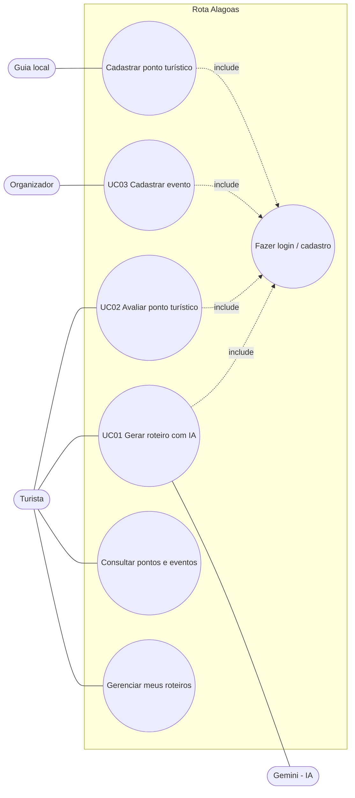

# 2. Histórias de Usuário e Casos de Uso — Rota Alagoas

## 2.1 Histórias de usuário

### HU01 — Gerar roteiro com IA (RF07)
**Como** turista com poucos dias em Alagoas,
**quero** informar quantos dias tenho e o que gosto,
**para** receber um roteiro pronto, dia a dia, que caiba no meu tempo.

**Critérios de aceitação**
- Posso escolher de 1 a 7 dias, a data de chegada, cidade-base, interesses, companhia, ritmo e orçamento.
- O roteiro mostra, para cada dia, as atividades em ordem com horário sugerido e uma dica.
- Só aparecem lugares e eventos que existem no sistema.
- Se a IA estiver fora do ar, recebo mesmo assim um roteiro, com o aviso "montado sem IA".

### HU02 — Salvar e rever roteiros (RF08)
**Como** turista,
**quero** salvar os roteiros que gerei,
**para** consultar durante a viagem sem precisar gerar de novo.

**Critérios de aceitação**
- Todo roteiro gerado fica salvo em "Meus roteiros".
- Posso abrir e excluir qualquer roteiro meu.
- Não consigo ver roteiros de outro usuário.

### HU03 — Explorar e avaliar pontos turísticos (RF04, RF06)
**Como** turista,
**quero** buscar pontos turísticos por cidade e categoria e ver a nota de outros visitantes,
**para** decidir aonde ir, e depois deixar minha própria avaliação.

**Critérios de aceitação**
- Filtro por cidade, categoria e busca por nome.
- Cada ponto mostra nota média e quantidade de avaliações.
- Só posso avaliar logado como turista; nota de 1 a 5; se avaliar de novo, a avaliação é atualizada.

### HU04 — Cadastrar ponto turístico (RF02)
**Como** guia local,
**quero** cadastrar os pontos turísticos que conheço,
**para** que os turistas tenham informação confiável e o assistente possa sugeri-los.

**Critérios de aceitação**
- Campos obrigatórios: nome, cidade, categoria, descrição, duração média (min).
- Posso editar e excluir só os pontos que eu cadastrei.
- O ponto aparece na listagem logo após salvar.

### HU05 — Divulgar evento (RF03, RF05)
**Como** organizador de eventos,
**quero** cadastrar meus eventos com data, local e preço,
**para** que os visitantes descubram e o assistente coloque o evento no roteiro de quem estiver na cidade naquela data.

**Critérios de aceitação**
- A data de fim não pode ser anterior à de início.
- O evento aparece na agenda enquanto não tiver terminado.
- Se a data do evento cair no período da viagem, ele pode entrar no roteiro.

---

## 2.2 Casos de uso

### UC01 — Gerar roteiro com IA

| | |
|---|---|
| **Ator principal** | Turista |
| **Ator secundário** | Assistente de IA (Google Gemini) |
| **Requisitos** | RF07, RF08, RNF02, RN03, RN04, RN05 |
| **Pré-condição** | Turista logado. Existem pontos turísticos cadastrados. |
| **Pós-condição** | Roteiro salvo no banco (`roteiros` + `roteiro_itens`) e exibido na tela. |

**Fluxo principal**
1. O turista acessa "Montar roteiro".
2. O sistema exibe o formulário: data de chegada, número de dias (1–7), cidade-base, interesses, companhia, ritmo e orçamento.
3. O turista preenche e clica em "Gerar roteiro".
4. O sistema valida os dados.
5. O sistema busca no banco os pontos turísticos (com nota média) e os eventos que acontecem no período.
6. O sistema envia o perfil e os dados para a IA, pedindo resposta em JSON.
7. A IA devolve o roteiro.
8. O sistema valida o JSON e descarta itens com IDs que não existem.
9. O sistema grava o roteiro com `origem = 'ia'` e exibe o resultado dia a dia.

**Fluxos alternativos**
- **4a. Dados inválidos** (ex.: 0 dias, nenhum interesse): o sistema mostra a mensagem do campo e volta ao passo 2.
- **6a. IA indisponível** (sem chave, sem internet, *timeout*, erro HTTP) **ou 8a. resposta inválida / roteiro vazio**: o sistema executa o **plano B** (algoritmo local), grava com `origem = 'padrao'` e exibe o aviso "Roteiro montado sem IA". Segue para o passo 9.

### UC02 — Avaliar ponto turístico

| | |
|---|---|
| **Ator principal** | Turista |
| **Requisitos** | RF06, RN02 |
| **Pré-condição** | Turista logado. |
| **Pós-condição** | Avaliação gravada; média do ponto atualizada. |

**Fluxo principal**
1. O turista abre a página de um ponto turístico.
2. O sistema mostra descrição, nota média e avaliações.
3. O turista escolhe uma nota de 1 a 5, escreve um comentário (opcional) e envia.
4. O sistema valida a nota e grava a avaliação.
5. O sistema recarrega a página com a nova média.

**Fluxos alternativos**
- **3a. Usuário não logado ou não é turista**: o formulário não aparece; o sistema mostra "Entre como turista para avaliar".
- **4a. Nota fora de 1–5**: o sistema recusa e mostra mensagem.
- **4b. Turista já avaliou este ponto**: o sistema atualiza a avaliação existente em vez de criar outra.

### UC03 — Cadastrar evento

| | |
|---|---|
| **Ator principal** | Organizador de eventos |
| **Requisitos** | RF03, RF05, RN01, RN04 |
| **Pré-condição** | Organizador logado. |
| **Pós-condição** | Evento gravado e visível na agenda. |

**Fluxo principal**
1. O organizador acessa "Painel" → "Novo evento".
2. O sistema exibe o formulário.
3. O organizador informa título, descrição, cidade, local, início, fim, categoria e preço.
4. O sistema valida os campos.
5. O sistema grava o evento vinculado ao organizador.
6. O sistema volta ao painel com a mensagem "Evento salvo".

**Fluxos alternativos**
- **4a. Campo obrigatório vazio**: mensagem e volta ao passo 3.
- **4b. Data de fim anterior ao início**: mensagem "A data de fim deve ser depois do início".
- **1a. Usuário sem perfil organizador**: acesso negado.
