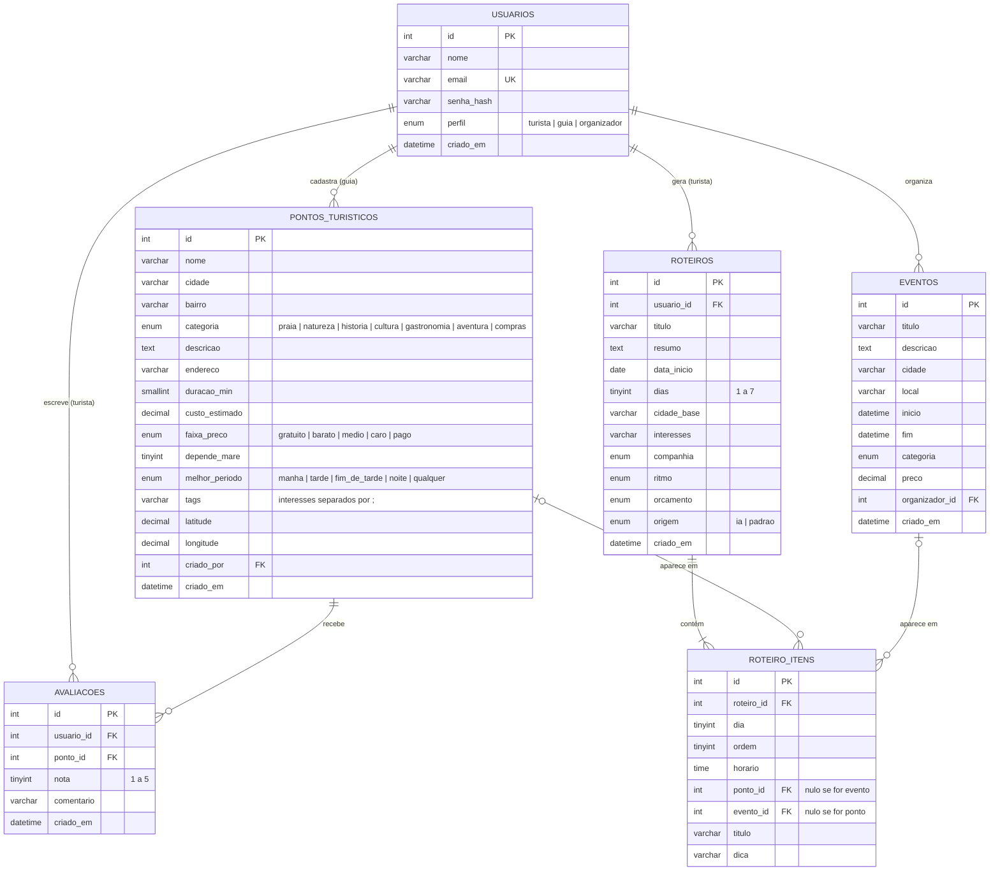

# 4. Modelo Entidade-Relacionamento

O script completo está em [`database/rota_alagoas.sql`](../database/rota_alagoas.sql).

## Decisões de modelagem

| Decisão | Por quê |
|---|---|
| Uma tabela `usuarios` com coluna `perfil` | Os três atores têm os mesmos dados de login; o perfil controla o que cada um pode fazer. |
| `avaliacoes` com `UNIQUE (usuario_id, ponto_id)` | Garante a RN02: uma avaliação por turista por ponto. A nota média é calculada com `AVG()`, não é guardada. |
| `CHECK (nota BETWEEN 1 AND 5)` e `CHECK (dias BETWEEN 1 AND 7)` | Regra de negócio também no banco, não só no PHP. |
| `roteiro_itens` com `ponto_id` **ou** `evento_id` | Um item do roteiro pode ser um lugar ou um evento. As duas FKs são opcionais. |
| `roteiro_itens.titulo` (cópia do nome) | Se o ponto for excluído (`ON DELETE SET NULL`), o roteiro antigo continua legível. |
| `roteiros.origem` | Registra se o roteiro veio da IA ou do plano B — útil para QA e para o pitch. |
| `ON DELETE CASCADE` em roteiros → itens e usuários → avaliações | Excluir um roteiro apaga seus itens; excluir usuário apaga o que é só dele. |
| Índices em `cidade`, `categoria` e `inicio` | São os campos usados nos filtros das listagens. |
| `tags`, `melhor_periodo` e `depende_mare` em `pontos_turisticos` | Vêm da planilha de pesquisa do grupo. A IA e o plano B usam esses campos para casar o lugar com o perfil, pôr cada atividade na hora certa e avisar da maré baixa. `tags` fica como texto separado por `;` (simples para o hackathon; o ideal seria uma tabela N:N). |

## Cardinalidades

- Um **guia** cadastra 0..N pontos; cada ponto tem exatamente 1 guia.
- Um **organizador** cadastra 0..N eventos; cada evento tem 1 organizador.
- Um **turista** escreve 0..N avaliações; cada ponto recebe 0..N avaliações (N:N resolvido pela tabela `avaliacoes`).
- Um **turista** gera 0..N roteiros; cada roteiro tem 1..N itens.
- Cada item referencia 0..1 ponto e 0..1 evento.
