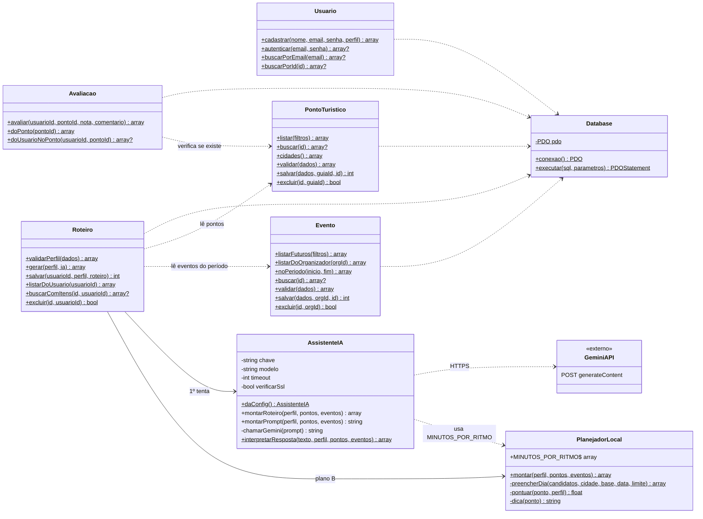

# 5. Diagrama de Classes

As classes ficam em `src/`. As páginas `.php` da raiz funcionam como controladores: recebem o formulário, chamam as classes e montam a tela.

## Responsabilidades

| Classe | Responsabilidade |
|---|---|
| `Database` | Conexão única (Singleton) com o MySQL via PDO; todas as consultas usam *prepared statements*. |
| `Usuario` | Cadastro com `password_hash`, login com `password_verify`. |
| `PontoTuristico` | CRUD e listagem com nota média (`AVG`) e filtros. Só o guia dono edita/exclui. |
| `Evento` | CRUD, agenda futura e busca de eventos dentro do período da viagem. |
| `Avaliacao` | Cria ou atualiza (`ON DUPLICATE KEY UPDATE`) a avaliação do turista. |
| `Roteiro` | Orquestra a geração: valida o perfil, busca dados, chama a IA, cai no plano B se der erro, grava em transação. |
| `AssistenteIA` | Monta o *prompt*, chama o Gemini e **valida** a resposta (descarta IDs inventados, pontos repetidos, eventos fora de data). |
| `PlanejadorLocal` | Plano B determinístico: pontua por interesse/nota/orçamento, agrupa por cidade e respeita o ritmo. |

## Padrões usados

- **Singleton** — `Database::conexao()`.
- **Strategy (simplificado)** — `Roteiro::gerar()` escolhe entre duas estratégias de geração (IA ou local) com a mesma saída.
- **Injeção de dependência** — `Roteiro::gerar($perfil, $ia)` aceita outro `AssistenteIA`, o que facilita os testes.
