# 6. Protótipo de Telas

Fluxo de navegação e capturas das telas do sistema (as imagens estão em `docs/prototipo/`).

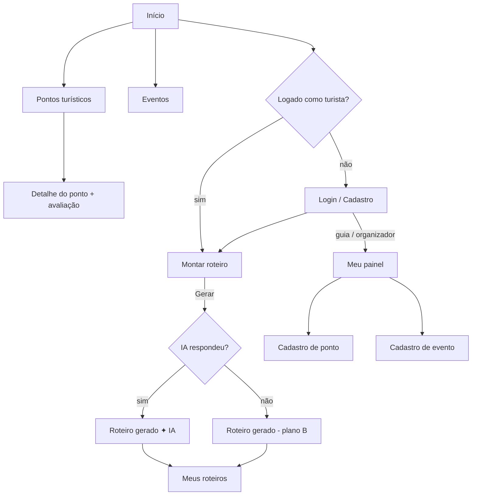

## Telas

### 1. Início
Destaques mais bem avaliados, próximos eventos e o botão principal "Montar meu roteiro".
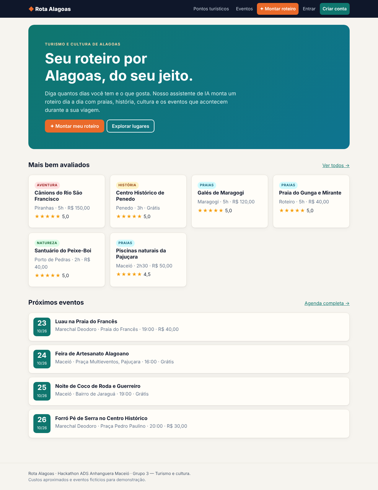

### 2. Pontos turísticos (RF04)
Busca por nome, filtro por cidade e categoria, nota média.
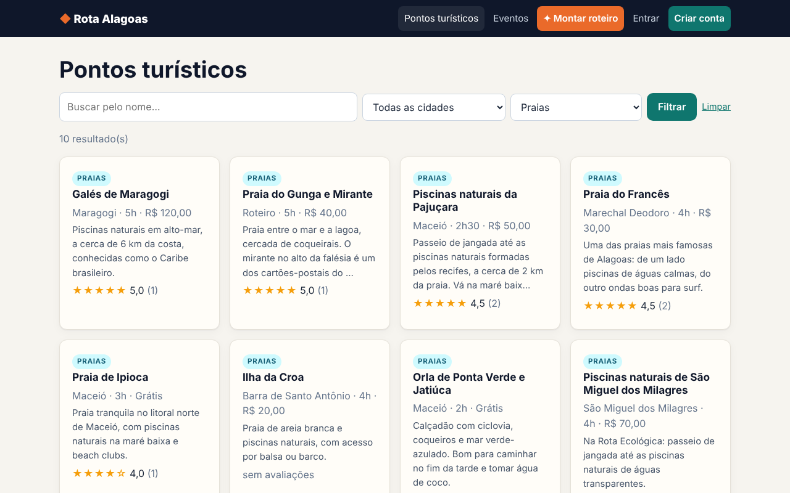

### 3. Detalhe do ponto + avaliação (RF06)
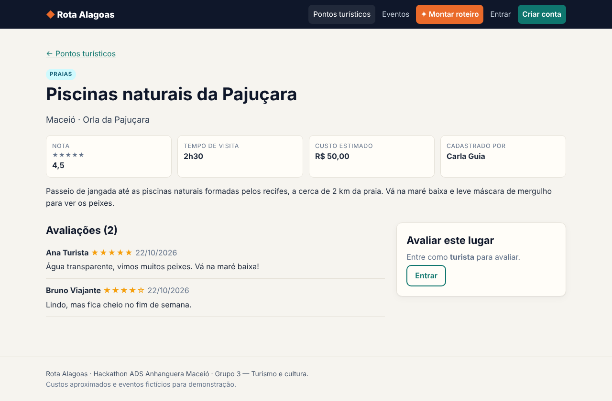

### 4. Agenda de eventos (RF05)
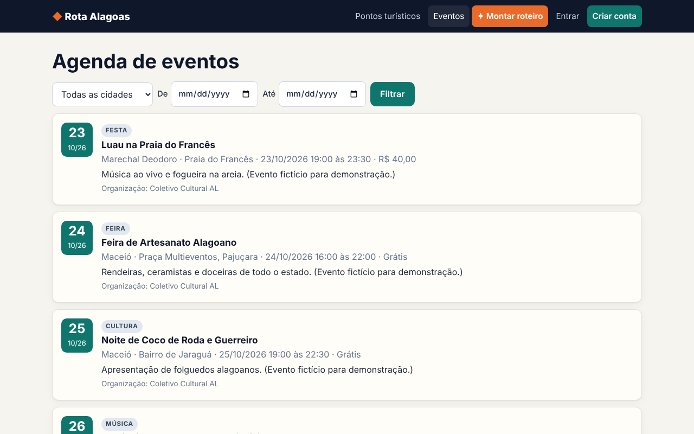

### 5. Login
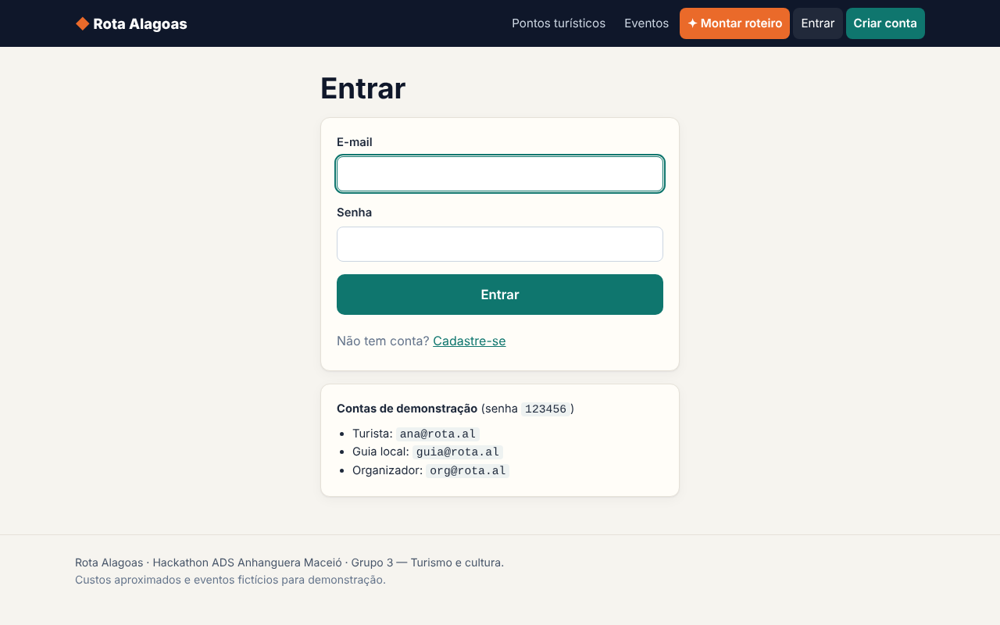

### 6. Montar roteiro — formulário do assistente de IA (RF07)
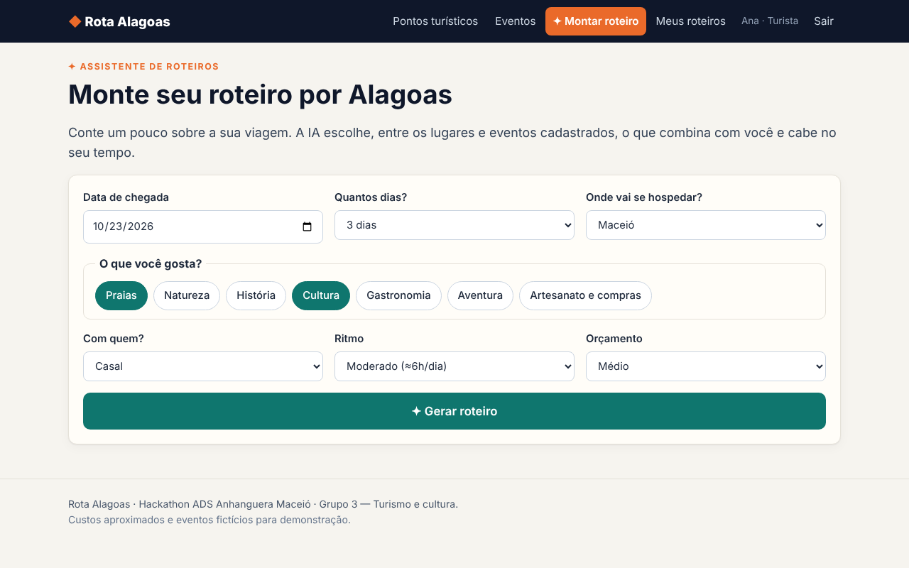

### 7. Roteiro gerado (RF07, RF08)
Linha do tempo por dia; selo indica se veio da IA ou do plano B.

### 8. Meus roteiros (RF08)
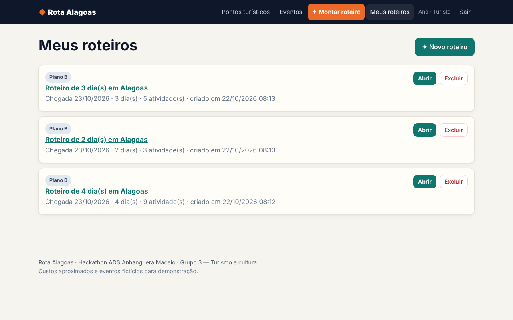

### 9. Painel do guia (RF02)
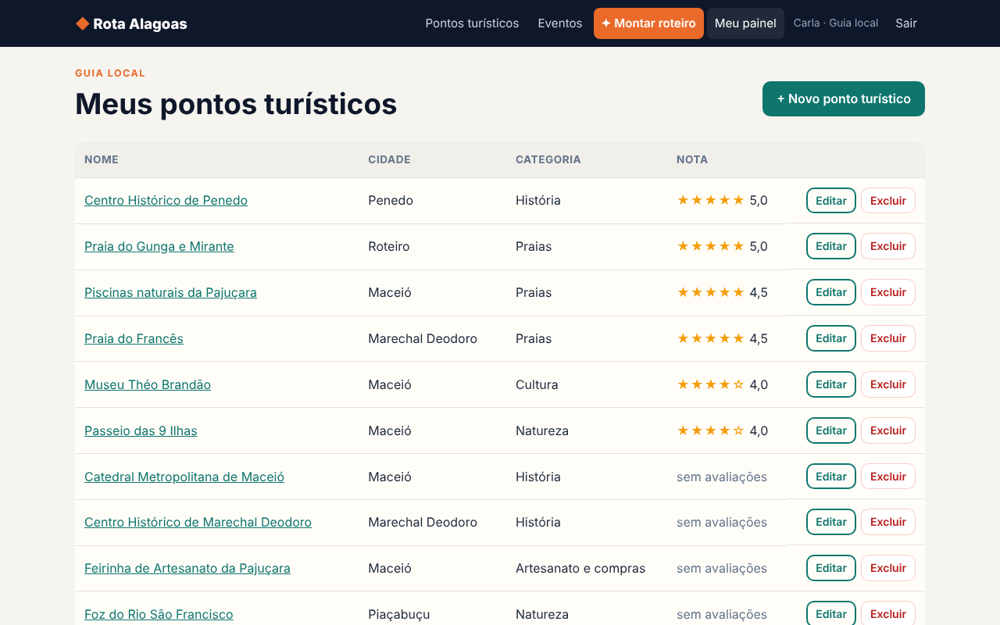

### 10. Cadastro de ponto turístico (RF02)
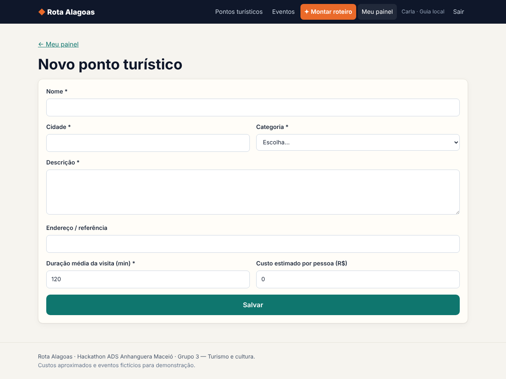

### 11. Cadastro de evento (RF03)
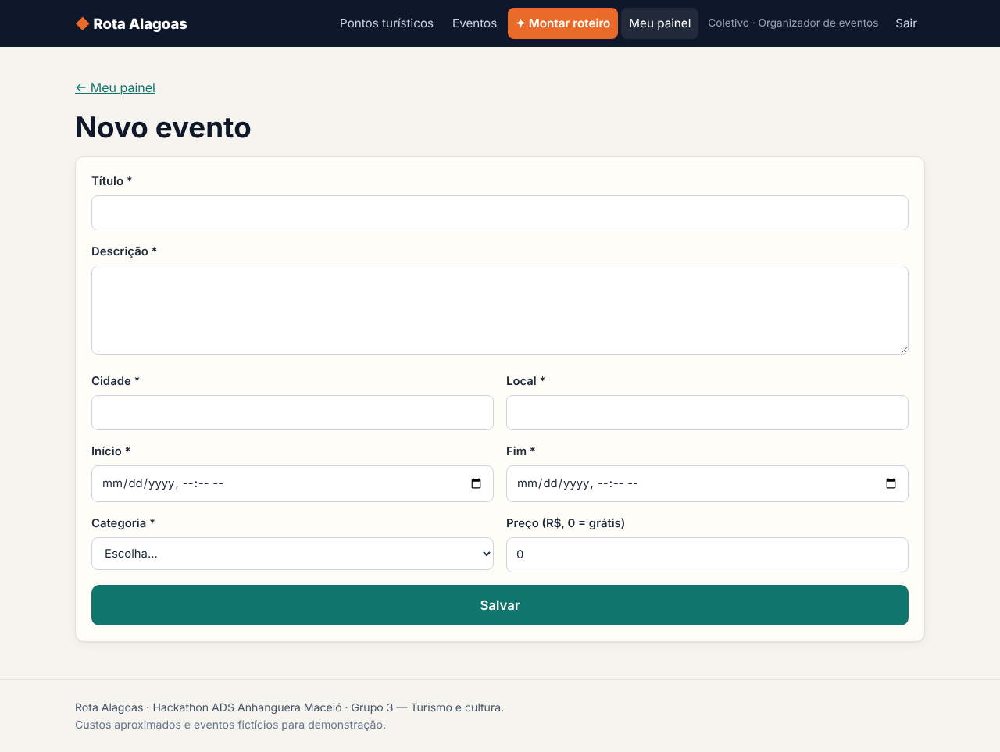

### 12. Versão celular (RNF03)
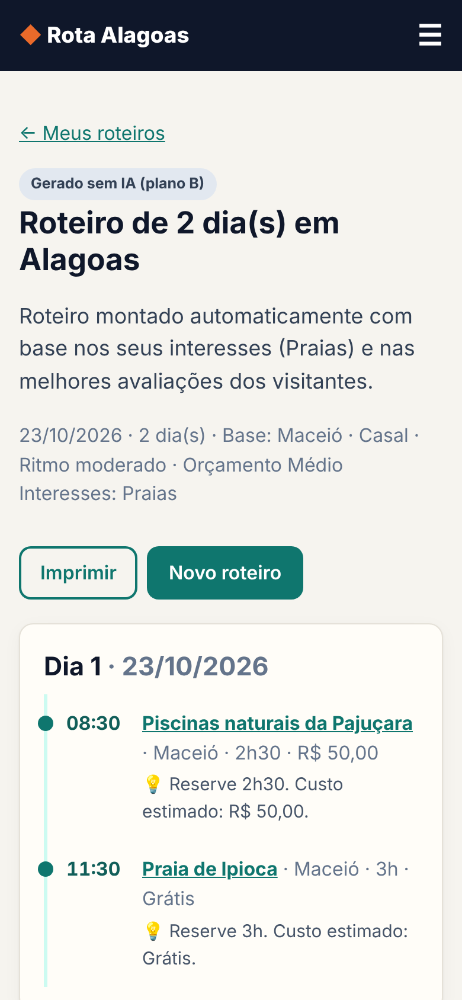

## Guia visual

| Elemento | Valor |
|---|---|
| Cor primária (verde-mar) | `#0f766e` |
| Cor de destaque (laranja, ação de IA) | `#ea6a2a` |
| Fundo | `#f6f4ef` (areia) |
| Texto | `#0f172a` |
| Fonte | Fonte do sistema (Segoe UI no Windows, Roboto no Android) |
| Ícone de IA | ✦ — sempre que algo envolve o assistente |
